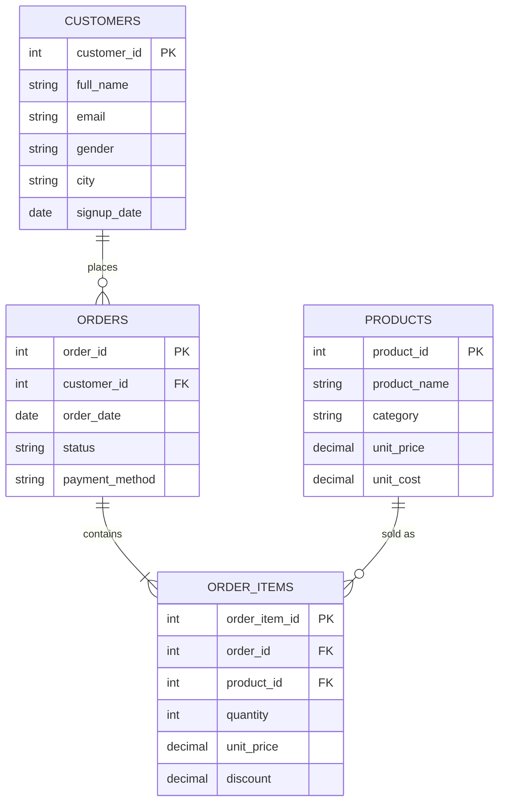

<h1 align="center">E-Commerce Sales & Customer Analytics</h1>

<p align="center">
  An end-to-end data analytics project: MySQL database design, data quality checks, a reusable SQL views layer,
  business analysis with advanced SQL, and a 4-page Power BI dashboard.
</p>

<p align="center">
  
  
  
  
</p>

---

## Table of Contents
1. [Project in Simple Words](#project-in-simple-words)
2. [Business Problem](#business-problem)
3. [Dashboard Preview](#dashboard-preview)
4. [Dataset and Data Model](#dataset-and-data-model)
5. [Project Structure](#project-structure)
6. [Workflow](#workflow)
7. [Business Questions Answered with SQL](#business-questions-answered-with-sql)
8. [Dashboard Details](#dashboard-details)
9. [Key Insights](#key-insights)
10. [Recommendations](#recommendations)
11. [Skills Demonstrated](#skills-demonstrated)
12. [How to Run](#how-to-run)

---

## Project in Simple Words

This is a **sample online store** (similar to Noon or Jumia) with customers, products and orders.
I built the database in MySQL, checked the data quality, and wrote SQL queries that answer the questions a store
owner would ask: how are sales growing, which products and cities perform best, which customers are the most
valuable, and which ones are about to leave. The results are shown in a Power BI dashboard.

> **Note on the data:** the dataset is **synthetic**. It was generated with AI for learning and portfolio purposes,
> so all numbers in this project (revenue, growth, retention, etc.) are illustrative and do not describe a real company.

---

## Business Problem

An online retailer sells in five categories (Electronics, Fashion, Home & Kitchen, Beauty, Sports) and delivers to
12 Egyptian cities. Management does not have one clear view of performance and wants answers to:

- How fast is the business growing, and how seasonal are the sales?
- Which categories, products and cities bring the most revenue and profit?
- Who are the best customers, and who is at risk of leaving?
- Do discounts increase profit, or only reduce the margin?
- Where is revenue lost through cancelled and returned orders?

---

## Dashboard Preview

The dashboard has four pages. It is built in Power BI on top of the SQL views.

**Page 1: Executive Overview**


**Page 2: Customer Segmentation & Retention**


**Page 3: Product & Category Performance**


**Page 4: Geographic Performance**


---

## Dataset and Data Model

The data is **synthetic (AI-generated)** but designed to behave like a real store: yearly growth, seasonality
(peak in November and December), uneven customer behaviour, discounts, cancellations and returns.
The CSV files are included in the `data/` folder.

| Table | Rows | Description |
|---|---|---|
| `customers` | 3,000 | Name, email, gender, city, signup date |
| `products` | 90 | Product, category, selling price, unit cost |
| `orders` | 20,000 | Order date, status, payment method |
| `order_items` | 35,013 | Products in each order, quantity, price, discount |

**Period:** January 2023 to December 2025. **Currency:** EGP.

**Order status:** 18,034 Completed, 1,198 Cancelled, 768 Returned.



**Business rules**
- Revenue and profit are calculated on `Completed` orders only.
- `net_revenue = quantity x unit_price x (1 - discount)`
- `profit = quantity x (unit_price x (1 - discount) - unit_cost)`

---

## Project Structure

```
ecommerce-sales-analytics/
├── data/                          # CSV files (customers, products, orders, order_items)
├── sql/
│   ├── 01_schema.sql              # Database, tables, constraints, indexes
│   ├── 02_load_data.sql           # Loads the CSV files into the tables (LOAD DATA LOCAL INFILE)
│   ├── 03_data_quality_checks.sql # Data validation
│   ├── 04_views.sql               # 4 views used by the dashboard
│   ├── 05_exploratory_analysis.sql
│   └── 06_business_analysis.sql   # 12 business questions
└── dashboard/
    ├── ecommerce_dashboard.pbix   # Power BI file
    └── powerbi_data/              # CSV exports of the 4 SQL views used by the dashboard
```

---

## Workflow

1. **Database design:** four related tables with primary keys, foreign keys, `CHECK` constraints and indexes.
2. **Data loading:** the CSV files are loaded into MySQL with `LOAD DATA LOCAL INFILE`.
3. **Data quality checks:** duplicate emails, orders without items, orders before signup, price mismatches,
   items sold below cost, future dates and NULL values.
4. **Views layer:** four views keep the business logic in one place:
   `vw_sales_fact`, `vw_monthly_kpis`, `vw_customer_rfm`, `vw_cohort_retention`.
5. **Exploration:** date range, order status split, prices per category, customers per city.
6. **Business analysis:** 12 queries that answer the questions below.
7. **Dashboard:** the four views were exported to CSV and loaded into Power BI Desktop.

---

## Business Questions Answered with SQL

| # | Question | Technique |
|---|---|---|
| 1 | What are the total revenue, profit, margin and average order value? | Aggregations |
| 2 | How do monthly revenue, MoM and YoY growth look? | `LAG`, running total, moving average |
| 3 | Which categories bring the most revenue and margin? | Share of total with window function |
| 4 | What are the top 3 products in each category? | `RANK() OVER (PARTITION BY ...)` |
| 5 | What share of customers generates 80% of revenue? | Pareto with cumulative window |
| 6 | How can customers be segmented by value? | RFM with `NTILE` |
| 7 | How many customers come back after their first purchase? | Cohort retention |
| 8 | Which products are bought together? | Self join (market basket) |
| 9 | Which payment method has more cancellations and returns? | Conditional aggregation |
| 10 | Which cities bring the most revenue per customer? | `DENSE_RANK` |
| 11 | Do discounts pay off? | `CASE` buckets |
| 12 | Which weekdays sell the most? | Date functions |

**Example: RFM segmentation (from `04_views.sql`)**
```sql
WITH snapshot AS (SELECT MAX(order_date) AS d FROM vw_sales_fact),
rfm AS (
    SELECT f.customer_id,
           DATEDIFF(s.d, MAX(f.order_date)) AS recency_days,
           COUNT(DISTINCT f.order_id)       AS frequency,
           SUM(f.net_revenue)               AS monetary
    FROM vw_sales_fact f CROSS JOIN snapshot s
    GROUP BY f.customer_id, s.d
)
SELECT customer_id, recency_days, frequency, monetary,
       NTILE(5) OVER (ORDER BY recency_days DESC) AS r_score,
       NTILE(5) OVER (ORDER BY frequency)         AS f_score,
       NTILE(5) OVER (ORDER BY monetary)          AS m_score
FROM rfm;
```

---

## Dashboard Details

The dashboard has four pages. It is built in **Power BI Desktop** (free version) on top of the SQL views,
and the `.pbix` file is in the `dashboard/` folder.

**Page 1: Executive Overview**
- KPI cards: Total Revenue, Total Profit, Orders, Average Order Value
- Monthly revenue trend, monthly profit trend, monthly growth %
- Revenue by category, order distribution by payment method
- Slicers: product category, city, year

**Page 2: Customer Segmentation & Retention**
- KPI cards: Total Customers (customers with at least one completed purchase), Retention Rate, At-Risk Customers, Total Monetary Value
- Cohort retention curves
- Customer distribution by segment
- Customer share vs revenue share by segment
- RFM analysis (frequency vs recency)
- Slicers: segment, date

**Page 3: Product & Category Performance**
- KPI cards: Top Selling Product, Top Category by Profit, Margin %
- Profit margin vs revenue by product (finds high revenue, low margin products)
- Units sold vs revenue for the top 10 products
- Discount impact on units per item and margin
- Slicers: year/quarter/month, category

**Page 4: Geographic Performance**
- KPI cards: Top Revenue City, Most Profitable City, Active Cities, Fastest Growing City
- Revenue by city and category (stacked bar)
- Revenue vs profitability by city
- Customers by city and segment
- Slicers: year/quarter/month, city, category

---

## Key Insights

> These insights come from **synthetic data**, so the exact figures (especially the very high yearly growth) are
> illustrative. What matters is the analysis method and the type of conclusions it produces.

- **Overall:** the store generated 93.82M EGP revenue and 28.70M EGP profit (30.6% margin) from 18,034 completed orders, with an average order value of 5.20K EGP.
- **Growth and seasonality:** revenue grew from 5.10M EGP in 2023 to 20.81M in 2024 (+308%) and 67.90M in 2025 (+226%). Sales climb through each year and jump sharply in November and December, the peak months.
- **Categories:** Electronics leads with 36M EGP (about 38% of revenue), followed by Sports (22M) and Home & Kitchen (18M). Fashion (10M) and Beauty (8M) are the smallest.
- **Products:** Laptop Pro is the top selling product by revenue, but its margin is below the store average, so its pricing deserves a review.
- **Discounts:** units per item stay flat (about 1.4) from 0% to 20% discount, while margin drops from about 34% to about 18%. Deep discounts cut profit without lifting volume.
- **Customers:** 1,069 customers (40% of the 2,670 who purchased) generate 80% of the revenue. Champions are about 21% of buying customers but bring 47% of revenue. Lost customers are the largest group (26%) but bring only 7% of revenue. At-Risk customers (14% of customers, 15% of revenue) are the best win-back target.
- **Retention:** the average retention rate is 32.81%.
- **Cities:** Cairo is the top revenue city (about 28M EGP, around 30% of total) and also the most profitable. Giza and Alexandria follow with about 14M each. Mansoura is the fastest growing city. Margins are similar across cities (about 29% to 31%).
- **Operations:** Credit Card has the highest cancellation rate (6.60%), followed by Wallet (6.01%). Bank Transfer has the lowest (4.68%).

---

## Recommendations

1. Keep the best customers happy with loyalty offers, and run win-back campaigns for customers at risk.
2. Prepare stock and marketing before the November and December peak.
3. Review prices of products with high revenue and low margin.
4. Limit deep discounts: 15-20% discounts cut margin from about 34% to 18% with no volume gain.
5. Reduce cancellations on Credit Card orders (6.60%), for example with payment retry reminders and clearer checkout steps.
6. Use products that are often bought together for bundles and cross-selling.

---

## Skills Demonstrated

- **SQL (MySQL):** CTEs, window functions (`LAG`, `RANK`, `DENSE_RANK`, `NTILE`, `ROW_NUMBER`), running totals,
  conditional aggregation, self joins, views, constraints and indexes
- **Analytics:** RFM segmentation, cohort retention, Pareto analysis, market basket, growth metrics
- **Data quality:** validation checks before analysis
- **Power BI:** data modeling, DAX measures, interactive slicers, dashboard design

---

## How to Run

**Requirements:** MySQL 8.0.16 or later (MySQL Workbench is recommended). To open the dashboard you need
[Power BI Desktop](https://powerbi.microsoft.com/desktop/) (free).

**1. Clone the repository**
```bash
git clone https://github.com/amalyasser133/ecommerce-sales-analytics.git
cd ecommerce-sales-analytics
```

**2. Create the database and tables**
```bash
mysql -u root -p < sql/01_schema.sql
```

**3. Load the data**

`02_load_data.sql` uses `LOAD DATA LOCAL INFILE` with **absolute file paths**. Before running it:

- Open `sql/02_load_data.sql` and change each path (for example `D:/sql/ecommerce-sql-analytics/data/customers.csv`)
  so it points to the `data/` folder on **your** computer. Use forward slashes `/` on Windows.
- Make sure `local_infile` is enabled on the MySQL server. If it is not, run this once as an admin user:
  ```sql
  SET GLOBAL local_infile = 1;
  ```

Then run:
```bash
mysql --local-infile=1 -u root -p ecommerce < sql/02_load_data.sql
```

**4. Run the checks, views and analysis**
```bash
mysql -u root -p < sql/03_data_quality_checks.sql
mysql -u root -p < sql/04_views.sql
mysql -u root -p < sql/05_exploratory_analysis.sql
mysql -u root -p < sql/06_business_analysis.sql
```

> **Warning:** `01_schema.sql` drops and recreates the tables. Do not run it on a database with real data.

**5. Check that the data loaded**
```sql
USE ecommerce;
SELECT COUNT(*) FROM orders;   -- expected: 20000
```

**6. Open the dashboard:** open `dashboard/ecommerce_dashboard.pbix` in Power BI Desktop. The dashboard is built from
CSV exports of the four views (`sales_fact`, `monthly_kpis`, `customer_rfm`, `cohort_retention`) stored in
`dashboard/powerbi_data/`.
If Power BI cannot find the files, go to **Transform data > Data source settings** and point each source to the
matching file in `dashboard/powerbi_data/`.
